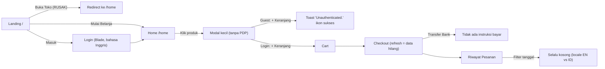

# PROJECT REVIEW — MySembako (Audit Frontend UI/UX)

**Tanggal audit:** 4 Oktober 2026
**Cakupan:** Frontend customer-facing (React SPA + halaman auth Blade)
**Tujuan:** Menyiapkan project sebagai **portofolio UI/UX untuk magang E-commerce TikTok Shop**
**Metode:** Review kode semua halaman & komponen, pemetaan user flow, heuristik Nielsen, WCAG 2.2 AA, dan perbandingan dengan pola UI marketplace (TikTok Shop / Tokopedia / Shopee)

> ⚠️ Review sebelumnya (status "✅ Semua masalah telah diperbaiki") **sudah tidak akurat**. File seperti `components/commons/molecules/HomePage` dan `SearchBar` sudah tidak ada, dan `resources/routes/AppRoutes.jsx` masih ada sebagai file kosong (0 byte).

---

## 1. Ringkasan Eksekutif

Secara visual MySembako **sudah lumayan modern**: palet stone + orange, sudut membulat, bento grid di landing, dan floating bottom nav. Masalahnya ada di **lapisan UX**. Ada beberapa CTA yang rusak, input yang terlihat ada tapi tidak berfungsi, state loading/error yang tidak ditangani, feedback memakai `alert()` bawaan browser, dan tidak ada halaman detail produk. Recruiter UI/UX biasanya justru menilai detail-detail seperti ini.

Untuk portofolio TikTok Shop, gap terbesarnya adalah **pola inti social commerce yang belum ada**: halaman detail produk (PDP), social proof (rating & jumlah terjual), keranjang yang dikelompokkan per toko, sticky CTA di mobile, voucher, dan pelacakan pesanan.

### Skor Saat Ini (penilaian subjektif, skala 10)

| Aspek | Skor | Catatan singkat |
|---|:-:|---|
| Visual design (estetika) | 6.5 | Bersih & modern, tapi foto produk masih placeholder teks |
| Konsistensi / design system | 4 | Banyak style duplikat, 2 font berbeda, warna hard-coded |
| Alur e-commerce (flow) | 4.5 | Tidak ada PDP, ada CTA rusak, guest flow buntu |
| Feedback & state UI | 4 | `alert()`/`confirm()`, tidak ada skeleton, error tidak ditangani |
| Aksesibilitas | 3 | Modal tanpa focus trap/Esc, card tidak bisa diakses keyboard, teks 10px |
| Mobile-first | 6 | Grid responsif oke, tapi touch target kecil & tidak ada sticky CTA |
| Performa | 5 | Gambar hero 847KB, aset 1.8MB tidak terpakai, favicon 0 byte |
| **Kesiapan portofolio** | **4** | Belum ada live demo, case study, atau before/after |

### Peta Masalah pada User Flow



---

## 2. Prioritas Perbaikan

- **P0 — Bug / blocker**: merusak alur, harus diperbaiki duluan (≈1–2 hari)
- **P1 — UX mayor**: berpengaruh besar ke kesan profesional & konversi
- **P2 — Polish**: detail yang membedakan portofolio "bagus" dengan "sangat bagus"

---

## 3. P0 — Bug yang Merusak UX (Status: ✅ SEMUA TELAH DIPERBAIKI)

| # | Masalah | Dampak | Status & Solusi |
|---|---|---|---|
| P0-1 | CTA "Buka Toko Gratis", "Daftarkan Tokomu", dan "Daftar Sekarang" memakai `<Link>` React Router ke `/buka-toko` | 3 CTA utama di landing tidak berfungsi | ✅ **DIPERBAIKI**: Diganti dengan `<a href="/buka-toko">` dan `<a href="/login">` untuk native navigation ke route Blade tanpa kena client router catch-all. |
| P0-2 | Search bar & tombol filter di TopNavbar tampil di Cart/Checkout/Pesanan/Lokasi tanpa handler | User mengetik dan tidak terjadi apa-apa (dead UI) | ✅ **DIPERBAIKI**: TopNavbar mendukung mode `variant="minimal"` untuk checkout, serta auto-redirect pencarian dari halaman mana pun ke `/home?q=...`. |
| P0-3 | Saat produk sedang di-fetch, Home langsung menampilkan "Produk Tidak Ditemukan" | Flash of empty state, error jaringan disangka tidak ada produk | ✅ **DIPERBAIKI**: Ditambahkan state `loading`, `error`, dan `empty`. Menampilkan shimmer `ProductGridSkeleton` dan `EmptyState` dengan tombol coba lagi. |
| P0-4 | Guest yang klik "Tambah ke Keranjang" mendapat toast "Unauthenticated." dengan ikon centang hijau | Pesan membingungkan & sinyal visual salah | ✅ **DIPERBAIKI**: Context Cart & Toast mendeteksi 401 dan menampilkan toast warning ramah: "Silakan masuk untuk menambahkan barang ke keranjang" lengkap dengan tombol "Masuk". |
| P0-5 | Filter tanggal di Riwayat Pesanan selalu kosong karena perbedaan format & locale (EN vs ID) | Fitur tidak berfungsi & tanggal bahasa Inggris | ✅ **DIPERBAIKI**: `OrderController` mengirimkan field `date` (`YYYY-MM-DD`) dan `created_at_iso`. Frontend mencocokkan tanggal langsung dan memformat nama bulan Indonesia via `Intl.DateTimeFormat`. |
| P0-6 | Tombol "Lihat Detail Koordinat" tidak melakukan apa-apa kalau kota sudah tersimpan | Tombol mati | ✅ **DIPERBAIKI**: Koordinat & detail lokasi sinkron dengan `AuthContext`, modal koordinat dapat dibuka kapan saja dan menyertakan koordinat GPS terkini. |
| P0-7 | Animasi `animate-in`, `fade-in` dsb. didefinisikan di `global.css` tapi file tidak pernah di-import | Modal & toast muncul tanpa transisi halus | ✅ **DIPERBAIKI**: Keyframes dan utilitas animasi (`animate-fadeIn`, `animate-slideUp`, `animate-drawer`, `skeleton-shimmer`) dipindahkan ke `resources/css/app.css` (@theme). File dead `global.css` & `font.css` dihapus. |
| P0-8 | Checkout bergantung pada `location.state`. Kalau di-refresh, data checkout hilang | Data checkout hilang diam-diam | ✅ **DIPERBAIKI**: Keranjang menyimpan item terpilih di `sessionStorage` sebagai fallback cadangan. Refresh di `/checkout` tetap mempertahankan item yang dipesan. |
| P0-9 | Logo di TopNavbar mengarah ke `/` (landing marketing) bukan ke `/home` | User terlempar keluar dari app belanja | ✅ **DIPERBAIKI**: Logo diarahkan ke `/home` secara konsisten. |

---

## 4. P1 — Masalah UX Mayor (per halaman)

### 4.1 Global / Lintas Halaman

| # | Masalah | Rekomendasi |
|---|---|---|
| G-1 | **Tidak ada design system.** Warna (`bg-[#FAFAF8]`, `orange-600`), radius, dan shadow di-hard-code di setiap file. Tombol, input, modal, spinner, dan empty state ditulis ulang di setiap halaman | Definisikan token di `@theme` ([app.css](file:///e:/Kuliah/Software%20Engineering/MySembako-main/resources/css/app.css)): `--color-brand-*`, `--color-surface`, `--radius-card`, dll. Buat komponen: `Button`, `IconButton`, `Input`, `Modal/BottomSheet`, `Toast`, `ProductCard`, `PriceTag`, `QuantityStepper`, `EmptyState`, `Skeleton`, `Badge` |
| G-2 | Feedback memakai `alert()` / `confirm()` bawaan browser (±20 tempat) | Ganti dengan sistem `Toast` (context) dan `ConfirmDialog`. Ini termasuk perubahan yang paling terasa di demo |
| G-3 | Modal tidak punya `role="dialog"`, `aria-modal`, focus trap, tutup dengan Esc, maupun scroll lock. Modal produk & alamat juga tidak bisa ditutup dengan klik backdrop | Buat satu komponen `Modal` reusable. Di mobile, tampilkan sebagai **bottom sheet** (pola TikTok Shop) |
| G-4 | Tiga sumber style saling bertentangan: `app.css` (Plus Jakarta Sans), `global.css` (Poppins, `a { color: blue }`, `input { margin-bottom: 14px }`), dan Blade auth (Poppins, `#ef6b49`) | Satu font (Plus Jakarta Sans), satu warna brand, hapus CSS yang mati |
| G-5 | `TopNavbar` ±700 baris berisi navbar, modal profil, modal filter, dan logika GPS sekaligus. Setiap halaman memanggil `/api/user` 2× (TopNavbar + halaman itu sendiri) | Pecah menjadi `ProfileSheet`, `FilterSheet`, dan `useUser()` (context/cache) |
| G-6 | Format harga ditulis berbeda-beda (`formatRupiah`, `toLocaleString`, `"Rp " + ...`). `item.price.toLocaleString` akan crash jika harga berupa string | Buat `utils/format.js` → `formatRupiah()` & `formatDate()` |
| G-7 | Copy campur Inggris–Indonesia: status "Pending/Paid/Shipped/Done/Cancel", login "Welcome to MySembako / New here?", `<html lang="en">` | Seragamkan ke Bahasa Indonesia, `lang="id"` |
| G-8 | `document.title` sama untuk semua route, tanpa meta description/OG, dan [favicon.ico](file:///e:/Kuliah/Software%20Engineering/MySembako-main/public/favicon.ico) berukuran 0 byte | Atur judul per halaman, tambahkan meta + OG image + favicon/PWA icon + `theme-color` |
| G-9 | Foto produk berupa **placeholder teks** (PNG 2KB bertuliskan "Beras Premium 5kg") | Ganti dengan foto produk asli/generated berlatar seragam. Ini dampak visual terbesar untuk screenshot portofolio |

### 4.2 Landing — [Intro](file:///e:/Kuliah/Software%20Engineering/MySembako-main/resources/js/pages/Intro/index.jsx)
- ✅ Kekuatan: hero asimetris, bento grid, hierarki tipografi jelas.
- Belum ada social proof yang konkret (jumlah toko, kota, pesanan, testimoni). Klaim "ribuan tetangga" tidak didukung angka.
- Tidak ada preview produk/kategori. Tambahkan strip "Produk Populer" yang mengambil data dari `/api/products`.
- Hero image 847KB tanpa `srcset`/WebP, dan tanpa `width/height` (rawan CLS).
- Link `/login` melewati `LoginRedirect` sehingga muncul teks tanpa style "Mengarahkan ke halaman login..." ([AppRoutes L11-16](file:///e:/Kuliah/Software%20Engineering/MySembako-main/resources/js/routes/AppRoutes.jsx#L11-L16)). Gunakan `<a href>` langsung.

### 4.3 Home / Katalog — [HomePage](file:///e:/Kuliah/Software%20Engineering/MySembako-main/resources/js/pages/HomePage/index.jsx)
| # | Masalah | Rekomendasi |
|---|---|---|
| H-1 | **Tidak ada halaman detail produk (PDP)**. Yang ada hanya modal kecil, tanpa URL yang bisa dibagikan, galeri, deskripsi lengkap, info toko, atau ulasan | Buat route `/product/:id` (pola TikTok Shop: media carousel → harga & badge → varian → info toko → ulasan → sticky bar "Keranjang \| Beli Sekarang") |
| H-2 | Anatomi product card kurang informatif dibanding marketplace. Tidak ada rating, jumlah terjual, badge diskon/gratis ongkir, atau lokasi toko | Card: gambar 1:1 → nama (2 baris) → harga (+ coret) → ⭐ 4.8 · 1rb+ terjual → kota toko. Badge stok hanya muncul saat **stok menipis (<10)** sebagai *scarcity cue*, bukan "Sisa 120" |
| H-3 | Card berupa `<div onClick>` (tidak bisa difokus keyboard) dengan `<button>` "+" di dalamnya yang tidak punya aksi sendiri | Card → `<Link to="/product/:id">`. Tombol "+" → quick-add dengan `stopPropagation` |
| H-4 | Filter kategori ada di 3 tempat: pill di Home, pill di modal filter, dan input teks "ketik kategori". Tombol "Terapkan Filter" menyesatkan karena filter sudah langsung diterapkan | Pill di Home sudah cukup untuk kategori. Modal filter cukup untuk sort + rentang harga. Ganti label jadi "Lihat N produk" |
| H-5 | State filter/search tidak tersimpan di URL | Sinkronkan ke `?q=&cat=&sort=` agar bisa dibagikan & tombol back berfungsi |
| H-6 | Banner promo statis tanpa aksi | Carousel promo / Flash Sale dengan countdown, plus section "Voucher untukmu" |
| H-7 | Tidak ada debounce, highlight hasil, riwayat pencarian, atau saran pencarian | Search overlay berisi recent & trending searches (pola TikTok Shop) |

### 4.4 Keranjang — [CartPage](file:///e:/Kuliah/Software%20Engineering/MySembako-main/resources/js/pages/CartPage/index.jsx)
| # | Masalah | Rekomendasi |
|---|---|---|
| C-1 | Item **tidak dikelompokkan per toko**, padahal ini marketplace multi-seller | Kelompokkan per toko dengan checkbox per toko (standar TikTok Shop/Tokopedia) |
| C-2 | Di mobile, ringkasan & tombol bayar ada di bawah daftar item, dan BottomNavbar ikut menutupi | **Sticky checkout bar** di bawah: ☑ Semua · Total Rp… · [Checkout (3)]. Sembunyikan BottomNavbar di halaman ini |
| C-3 | `CustomCheckbox` & `SelectAllCheckbox` didefinisikan **di dalam** komponen, jadi di-remount setiap render (fokus keyboard hilang) | Pindahkan ke luar / jadikan komponen `Checkbox` reusable berbasis `<input type="checkbox">` |
| C-4 | Stepper qty: tanpa loading state, rawan race condition saat klik cepat, tombol "+" tidak disabled saat stok habis (memunculkan `alert`), touch target 28px | Optimistic update + debounce, disable di batas stok, ukuran tombol minimal 40–44px |
| C-5 | Hapus item memakai `confirm()` | Ganti dengan swipe-to-delete atau toast "Dihapus · Urungkan" |
| C-6 | "Ongkos Kirim Estimasi: Sesuai Alamat" (Cart) vs "Gratis (Area Sekitar)" (Checkout) | Seragamkan informasi ongkir |
| C-7 | Badge jumlah item tidak tampil di ikon keranjang BottomNavbar | Tambahkan counter badge (dari `CartContext`) |

### 4.5 Checkout — [CheckoutPage](file:///e:/Kuliah/Software%20Engineering/MySembako-main/resources/js/pages/CheckoutPage/index.jsx)
| # | Masalah | Rekomendasi |
|---|---|---|
| K-1 | BottomNavbar tetap tampil di checkout dan menjadi distraksi saat user hendak bayar | Sembunyikan nav dan pakai header ringkas "← Checkout" |
| K-2 | Di mobile, tombol "Konfirmasi & Buat Pesanan" ada di paling bawah halaman | Sticky bottom bar: Total + CTA |
| K-3 | Memilih "Transfer Bank / QRIS" tidak disusul instruksi pembayaran apa pun | Tambahkan halaman "Menunggu Pembayaran": nomor VA/QR, countdown batas bayar, tombol salin |
| K-4 | Tidak ada voucher/promo, catatan untuk penjual, atau pilihan jadwal kirim | Tambahkan baris "Voucher Toko / Platform" dan "Catatan" (pola TikTok Shop) |
| K-5 | Form alamat: `type="text"` untuk telepon & kode pos, tanpa validasi inline, tanpa loading saat submit, dan modal tidak bisa ditutup dengan Esc/backdrop | `type="tel"`, `inputMode="numeric"`, `autoComplete` (`street-address`, `postal-code`), error di bawah field, spinner pada tombol simpan |
| K-6 | Section "Informasi Pembeli" (nomor 2) hanya menampilkan data read-only, sehingga menambah panjang halaman | Gabungkan ke kartu alamat (nama + telepon penerima) |
| K-7 | Setelah order berhasil, user langsung dilempar ke daftar pesanan | Tampilkan **halaman sukses** (ilustrasi, nomor pesanan, ringkasan, CTA "Lihat Pesanan" / "Belanja Lagi") |

### 4.6 Riwayat Pesanan — [ReceiptPage](file:///e:/Kuliah/Software%20Engineering/MySembako-main/resources/js/pages/ReceiptPage/index.jsx)
- Belum ada **timeline status pesanan** (Dibuat → Dibayar → Dikirim → Selesai). Ini elemen penting untuk menunjukkan pemahaman post-purchase UX.
- Item pesanan ditampilkan tanpa thumbnail produk.
- Tidak ada halaman detail pesanan, CTA "Beli Lagi", maupun "Beri Ulasan" setelah status selesai.
- Status pill dibuat sebagai tab sticky lengkap dengan count (`Dikemas (2)`), dan yang aktif bisa di-scroll horizontal.
- Class `scrollbar-none` tidak ada di Tailwind ([L277](file:///e:/Kuliah/Software%20Engineering/MySembako-main/resources/js/pages/ReceiptPage/index.jsx#L277)). Yang benar `no-scrollbar`.
- Pembatalan & penyelesaian pesanan memakai `confirm()` + `alert()`.

### 4.7 Lokasi — [LocationPage](file:///e:/Kuliah/Software%20Engineering/MySembako-main/resources/js/pages/LocationPage/index.jsx)
- Product card di halaman ini **tidak bisa diklik** (dead end), padahal tampilannya sama dengan card di Home. Gunakan `ProductCard` yang sama.
- Jika tidak ada produk di kota user, halaman diam-diam menampilkan **semua produk** ([L103](file:///e:/Kuliah/Software%20Engineering/MySembako-main/resources/js/pages/LocationPage/index.jsx#L103)). Beri tahu user: "Belum ada toko di Semarang, menampilkan semua toko".
- Hanya mendukung 4 kota hard-coded ([location.js](file:///e:/Kuliah/Software%20Engineering/MySembako-main/resources/js/utils/location.js#L5-L10)). Tambahkan pilihan kota manual sebagai fallback kalau GPS ditolak.
- `window.location.href = "/home"` memicu full reload. Gunakan `navigate()`.
- Ada variabel `illustrationUrl` (flaticon) yang tidak terpakai.
- Pertimbangkan ulang IA-nya: "Lokasi" sebagai tab utama kurang lazim. Pola marketplace biasanya menaruh selector alamat/kota di header Home ("Dikirim ke: Semarang ▾"), sementara tab ke-4 dipakai untuk **Akun/Profil**.

### 4.8 Navigasi
- [BottomNavbar](file:///e:/Kuliah/Software%20Engineering/MySembako-main/resources/js/components/commons/molecules/BottomNavbar/index.jsx): memakai `<button onClick={navigate}>` (gunakan `<NavLink>`), tanpa `aria-current="page"`, dan label hanya muncul untuk tab aktif sehingga tab lain tidak berlabel. Di desktop, floating pill gaya mobile kurang pas. Pindahkan menu ke header saat `lg:`.
- Profil hanya bisa diakses dari ikon kecil di header. Guest tetap melihat tombol "Keluar dari Akun" dan nama "Pengguna", tanpa CTA "Masuk/Daftar".
- Ikon tercampur: SVG file on/off (`/icon/*.svg`) dan SVG inline bergaya lain. Pilih satu set (mis. Lucide) dengan stroke yang konsisten.

### 4.9 Halaman Auth (Blade) — [login.blade.php](file:///e:/Kuliah/Software%20Engineering/MySembako-main/resources/views/auth/login.blade.php)
- Bahasa visualnya berbeda total dengan app: font Poppins, input pill 40px, warna `#ef6b49`, link biru `#343bc5`, alert ala Bootstrap. Akibatnya perjalanan user terasa "pindah website".
- Copy masih bahasa Inggris ("Welcome to MySembako", "Login").
- Tidak ada "Lupa password", login sosial/OTP, maupun redirect kembali ke halaman asal.
- Rekomendasi: restyle memakai token & font yang sama (Tailwind via `@vite`), atau pindahkan login/register ke React.

---

## 5. Aksesibilitas (WCAG 2.2 AA)

| Temuan | Contoh lokasi | Perbaikan |
|---|---|---|
| Teks informatif 10–11px berwarna `stone-400/500` (kontras < 4.5:1) | [LocationPage L266](file:///e:/Kuliah/Software%20Engineering/MySembako-main/resources/js/pages/LocationPage/index.jsx#L266), badge di Home | Minimal 12px, gunakan `stone-600` ke atas untuk teks bermakna |
| Label form tidak terhubung ke input (`htmlFor`/`id`) | [TopNavbar L414-427](file:///e:/Kuliah/Software%20Engineering/MySembako-main/resources/js/components/commons/molecules/TopNavbar/index.jsx#L414-L427), form alamat | Komponen `Input` dengan `label` + `id` otomatis (`useId`) |
| `focus:outline-none` tanpa pengganti `focus-visible` | Tombol close modal | Tambahkan ring fokus global `focus-visible:ring-2 ring-brand-500` |
| Touch target < 44px | Stepper 28px, checkbox 20px, tombol close 28–32px | Minimal 44×44 (atau area klik diperluas dengan padding) |
| Toast tanpa `role="status"` / `aria-live` | [HomePage L511](file:///e:/Kuliah/Software%20Engineering/MySembako-main/resources/js/pages/HomePage/index.jsx#L511-L518) | `aria-live="polite"` |
| Tidak menghormati `prefers-reduced-motion` | Semua animasi | `motion-safe:` / `motion-reduce:` |
| Tanpa skip link, tanpa landmark `<main>` di Home | HomePage | Tambahkan `<main>` + skip link |

---

## 6. Performa & Aset

- `public/img/bumper.jpeg` (**1.8MB**), `Location.svg` (37KB), `Seting.svg`, `Search.svg`, dan `User.svg` **tidak dipakai**. Hapus.
- Hero 847KB → konversi ke WebP/AVIF ±100KB, tambahkan `srcset`, `width/height`, dan `fetchpriority="high"`.
- Tanpa code-splitting per route. Gunakan `React.lazy` + `Suspense` untuk Checkout/Receipt/Location.
- Font Google dimuat 5 weight. Cukup 400/600/800.
- Lakukan **Lighthouse (mobile)** sebelum & sesudah, lalu catat angkanya untuk case study.

---

## 7. Gap Fitur vs Pola TikTok Shop (Social Commerce)

> TikTok Shop di Indonesia beroperasi bersama Tokopedia, jadi pola UI keduanya relevan sebagai referensi.

| Pola | Status | Nilai untuk portofolio |
|---|:-:|---|
| Halaman detail produk + sticky "Keranjang / Beli Sekarang" | ❌ | ⭐⭐⭐ Wajib |
| Rating, jumlah terjual, ulasan dengan foto | ❌ | ⭐⭐⭐ |
| Keranjang dikelompokkan per toko | ❌ | ⭐⭐⭐ |
| Sticky bottom CTA di Cart/Checkout (mobile) | ❌ | ⭐⭐⭐ |
| Voucher / promo di checkout | ❌ | ⭐⭐ |
| Flash sale + countdown | ❌ | ⭐⭐ |
| Timeline pelacakan pesanan | ❌ | ⭐⭐ |
| Halaman toko (profil seller, follow, produk toko) | ❌ | ⭐⭐ |
| Konten video produk / "shoppable video" di PDP | ❌ | ⭐ Nilai tambah: menunjukkan pemahaman *content-driven commerce* |
| Skeleton loading & empty state berilustrasi | ⚠️ Sebagian | ⭐⭐ |
| Search overlay (riwayat & trending) | ❌ | ⭐ |

---

## 8. Roadmap Perbaikan

### Fase 0 — Stabilkan (Status: ✅ SELESAI)
- [x] Perbaiki semua **P0-1 s/d P0-9** (CTA, TopNavbar, Loading/Error, Toast 401, Filter tanggal, Detail GPS, Animasi CSS, Checkout refresh, Logo)
- [x] Hapus file mati: `global.css`, `font.css`, `resources/routes/AppRoutes.jsx`
- [x] `lang="id"`, favicon SVG, meta deskripsi & theme-color

### Fase 1 — Fondasi Design System (Status: ✅ SELESAI)
- [x] Token di `@theme` (`resources/css/app.css`): brand colors, surface, skeleton shimmer, animation keyframes, focus ring
- [x] Komponen inti: `Button`, `Input`, `Checkbox`, `Modal`, `ConfirmDialog`, `Skeleton` (`ProductGridSkeleton`), `EmptyState`, `Badge`, `QuantityStepper`, `PriceTag`, `ProductCard`
- [x] Utilities & Contexts: `utils/format.js` (`formatRupiah`, `formatDate`, `parsePrice`), `context/AuthContext.jsx`, `context/CartContext.jsx` (dengan dynamic badge counter real-time), `context/ToastContext.jsx`, `lib/api.js` (CSRF auto injection & error handling)
- [x] Ganti seluruh `alert/confirm` bawaan browser dengan Toast & ConfirmDialog

### Fase 2 — Redesign Alur Belanja Inti (± 1–2 minggu)
- [ ] Home: skeleton, product card baru, filter disederhanakan, state di URL, banner/flash sale
- [ ] **PDP baru** `/product/:id`
- [ ] Cart per toko + sticky checkout bar
- [ ] Checkout ringkas + sticky CTA + voucher + halaman sukses + instruksi bayar

### Fase 3 — Post-purchase & Konsistensi (± 1 minggu)
- [ ] Riwayat pesanan: tab berisi count, thumbnail, detail + timeline, "Beli Lagi"
- [ ] Tab "Akun" menggantikan "Lokasi", selector kota di header Home
- [ ] Restyle login/register agar konsisten dengan app
- [ ] Audit a11y (axe DevTools) & Lighthouse ≥ 90 di mobile

### Fase 4 — Kemas sebagai Portofolio
- [ ] **Live demo** (Railway/Render/VPS) + akun demo yang ditampilkan di halaman login ("Coba sebagai pembeli")
- [ ] **Case study** (Notion/Behance/website pribadi): Problem → Audit (pakai dokumen ini) → User flow → Wireframe → Design system → Before/After → Hasil
- [ ] Before/after screenshot setiap halaman (mobile 390px & desktop 1440px)
- [ ] Angka terukur: skor Lighthouse, jumlah langkah checkout, jumlah tap ke checkout, skor SUS dari 5 user test
- [ ] File Figma: design tokens, komponen, dan prototype alur Home → PDP → Checkout
- [ ] README dengan GIF demo alur belanja

---

## 9. Checklist Cepat untuk Portofolio

- [x] Tidak ada `alert()` / `confirm()` bawaan browser (diganti Toast & ConfirmDialog)
- [x] Setiap fetch punya state loading (skeleton), error (retry), dan empty
- [x] Semua tombol/link di setiap halaman berfungsi
- [x] Satu font (Plus Jakarta Sans), satu warna brand dominan (Pink #DB2777), tokens terpusat di `@theme`
- [ ] PDP + sticky CTA di mobile (Fase 2)
- [ ] Keranjang dikelompokkan per toko (Fase 2)
- [ ] Foto produk asli (bukan placeholder teks)
- [x] Semua copy Bahasa Indonesia & tanggal berformat `id-ID`
- [x] Modal bisa diakses keyboard (Esc, focus trap, aria-modal)
- [ ] Lighthouse mobile ≥ 90 (Performance, Accessibility, Best Practices)
- [ ] Live demo + akun demo + case study

---

## Lampiran — Setup Development

```bash
# Terminal 1
php artisan serve        # http://127.0.0.1:8000
# Terminal 2
npm run dev              # Vite :5173
```

**Stack:** Laravel 12 · React 19 · React Router 7 · Vite 7 · Tailwind CSS 4 · SQLite

**Struktur frontend saat ini:**
```
resources/js/
├── app.jsx                      # Entry (BrowserRouter)
├── routes/AppRoutes.jsx         # / · /home · /cart · /checkout · /receipt · /location
├── pages/{Intro,HomePage,CartPage,CheckoutPage,ReceiptPage,LocationPage}/
├── components/commons/molecules/{TopNavbar,BottomNavbar}/
├── utils/location.js
└── styles/{global,font}.css     # ⚠️ tidak di-import — kandidat hapus
resources/css/app.css            # CSS aktif (Tailwind + Plus Jakarta Sans)
resources/views/auth/*.blade.php # Login/Register (style terpisah)
```

> Catatan: audit ini berbasis review kode. Langkah verifikasi berikutnya: jalankan app, ambil screenshot "before" di 390px & 1440px, lalu jalankan Lighthouse + axe sebagai baseline case study.
